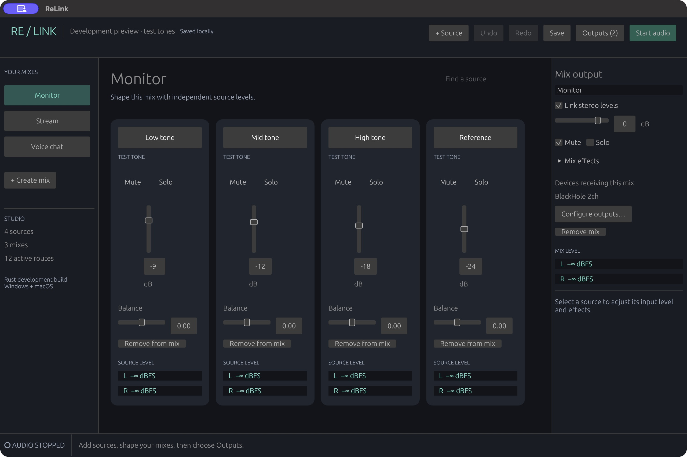

# ReLink

A proprietary Rust audio mixer and routing application under development for **Windows and macOS**, with independently authored virtual-device drivers. Reference research uses pinned Elgato Wave Link artifacts and [morluto/rea](https://github.com/morluto/rea). No Elgato code or artwork is packaged.

**Not a production release.** The original Swift/GPL prototype is archived under [`legacy/`](legacy/) and at tag `legacy-swift-gpl-freeze`. Its original licensing remains in force. New shipping targets do not depend on it.

The [current requirements and acceptance gates](research/RUST-MIGRATION.md) supersede the original prototype scope. Inputs and mix buses are dynamic; practical capacity is constrained by verified CPU, memory, devices and OS behavior, rather than a product-imposed channel count.

## Preview

The [pre-rename development preview](https://github.com/thatsmethen/relink/releases/tag/v0.1.0-preview.20261024) includes macOS Apple silicon and Windows x64 application ZIPs, screenshots and the original icon. [Package checks and download verification](research/evidence/rust-preview-40045963463/README.md) passed; production qualification remains incomplete. Installed-audio evidence is labelled separately.



[Mix effects screenshot](docs/screenshots/mix-effects-macos.png) · [Original app icon](packaging/branding/ravelink.svg)

These actual macOS screenshots show ReLink at `9cd350f`, with audio stopped and an explicit test-tone fixture. They do not demonstrate live hardware capture or Windows interaction. [Screenshot provenance](research/evidence/relink-screenshots-9cd350f/README.md) records the isolated source build, image hashes and exact restoration of the original studio.

## Rust workspace

The product is named ReLink. Existing crate names, executable identifiers, bundle ID and session paths remain compatible with earlier development builds.

- `ravelink-core`: validated sessions, routing, stereo mixing, meters and built-in DSP.
- `ravelink-audio`: CoreAudio/WASAPI device I/O, explicit output selection and runtime state.
- `ravelink-app`: Rust-native desktop interface using eframe/egui with AccessKit.
- `ravelink-hal`: original macOS AudioServerPlugIn through Apple's C ABI.
- `ravelink-windows-driver`: original Rust PortCls/WaveRT driver, built separately with its pinned kernel toolchain.

Both virtual drivers are implemented. Their qualification remains separate: independent clients have measured the installed macOS HAL, while the Windows driver has passed a native build, SDK ABI checks and unsigned package validation. Windows kernel installation, audio operation and signing remain unverified. See [platform research](docs/rust-platform-research.md).

```sh
cargo test --workspace
cargo run -p ravelink-app
```

On macOS, `scripts/build-macos-app.sh` builds `dist/macos/ReLink.app`. Windows CI packages the application as `ReLink.exe`; a direct `cargo build -p ravelink-app --release` retains the internal filename `target/release/ravelink-app.exe`.

Rust is pinned in `rust-toolchain.toml`. Current development targets are macOS and Windows; native builds and installed-driver acceptance are tracked separately. Audio starts stopped and requires an explicitly selected output. No system default audio device is changed.

The current runtime mixes explicitly selected device inputs and test tones into one selected output. Input, route and mix gain/mute/solo controls can update during playback without rebuilding the graph; callback acknowledgements track accepted targets, and [five-millisecond gain ramps](crates/ravelink-core/SMOOTHING.md) smooth those changes. Stop also cancels a start still queued by the interface. Device capture includes a bounded stereo queue and clock compensation; [capture evidence and backend limits](crates/ravelink-audio/CAPTURE.md) distinguish offline tests from native qualification. Application capture, simultaneous outputs and complete installed-runtime qualification remain required work.

Desktop CI at `01a2222` built release artifacts and passed deterministic tests on Windows Server 2022 and macOS 15 ([run evidence](research/evidence/rust-ci-40034960508/run.json)). The stopped native macOS interface was exercised with 128 sources, 32 mixes and 4,096 routes ([observations](research/evidence/rust-ui-scale/observation.json)); this does not establish audio capacity or Windows interaction quality.

At `6484db8`, the installed macOS HAL delivered two independently recorded stereo sine signals continuously, with bit-identical overlap between readers and silence after all clients restarted ([preserved PCM and measurements](research/evidence/rust-hal-installed-40039161891/)). The corresponding [Windows build evidence](research/evidence/rust-windows-native-40039161836/README.md) retains the original unsigned driver package. These checkpoints do not establish the full application's capture/mix/output path. Windows capture uses an original event-driven WASAPI adapter with explicit silent-packet and packet-lifetime handling. macOS capture now uses an original CoreAudio IOProc adapter with native sample timestamps, bounded PCM queues and retained callback ownership; [offline validation and source review](crates/ravelink-audio/NATIVE-CAPTURE-VALIDATION.md) do not establish native capture qualification. The current source also connects original CoreAudio and WASAPI output owners; CPAL supplies discovery, identity and configuration types. The [native-output checkpoint](crates/ravelink-audio/NATIVE-OUTPUT-VALIDATION.md) records offline review and a separate cleanup acceptance gate. Installed native-output qualification and Windows audio execution remain pending.

A [subsequent installed HAL observation](research/evidence/rust-hal-failed-40041055533/README.md) failed with 568 missing frames in one reader; another repeat passed. Both outcomes remain distinct, and the intermittent missed callback deadline is unresolved. The [first complete installed runtime observation](research/evidence/rust-runtime-installed-40042679024/README.md) also failed timestamp continuity despite passing every mixer PCM phase and live-control check. The separate [installed runtime protocol](drivers/macos/tests/RUNTIME-ACCEPTANCE.md) measures capture, mixing, live controls and stop through two independent cables with fixed PCM criteria.

The [first native-capture diagnostic observation](research/evidence/rust-native-runtime-installed-40046411757/README.md) failed with an Xrun during the first control phase; the existing record cannot distinguish its reporting path. Three [incidental observations](research/evidence/rust-incidental-hal-observations/README.md) also failed and remain separate results. Original archives are available on linked evidence release pages, with byte-for-byte public download verification. No passing subset replaces these failures.

The [first run with fault attribution](research/evidence/rust-attribution-installed-40048380199/README.md) identified a capture-consumer underflow on Cable 1 after 7.33 seconds. Its separate basic HAL observation passed, but the incomplete runtime sequence failed. This identifies the reporting path, not the scheduling cause.

At `db052e4`, [one complete installed application runtime observation](research/evidence/rust-ack-installed-40050165081/README.md) passed capture through mixing, all volume/mute/unmute phases, independent continuous PCM recording and silence after Stop. The separate basic HAL job also passed. Original archives and public download verification are preserved. This short successful observation does not resolve the earlier intermittent failures or qualify sustained reliability, native output adapters, multiple outputs or installed Windows audio.

ReLink retains the existing `RaveLinkRust/session.json` studio location in the user's application-data directory, separate from the archived prototype's studio. Permissively licensed dependencies retain their licenses. ASIO and GPL audio drivers are excluded from the shipping dependency graph.

See [LICENSE](LICENSE) for the new first-party proprietary notice and [legacy/LICENSE](legacy/LICENSE) for archived-code terms. Public repository visibility does not change the proprietary license or the archived code’s original terms.
